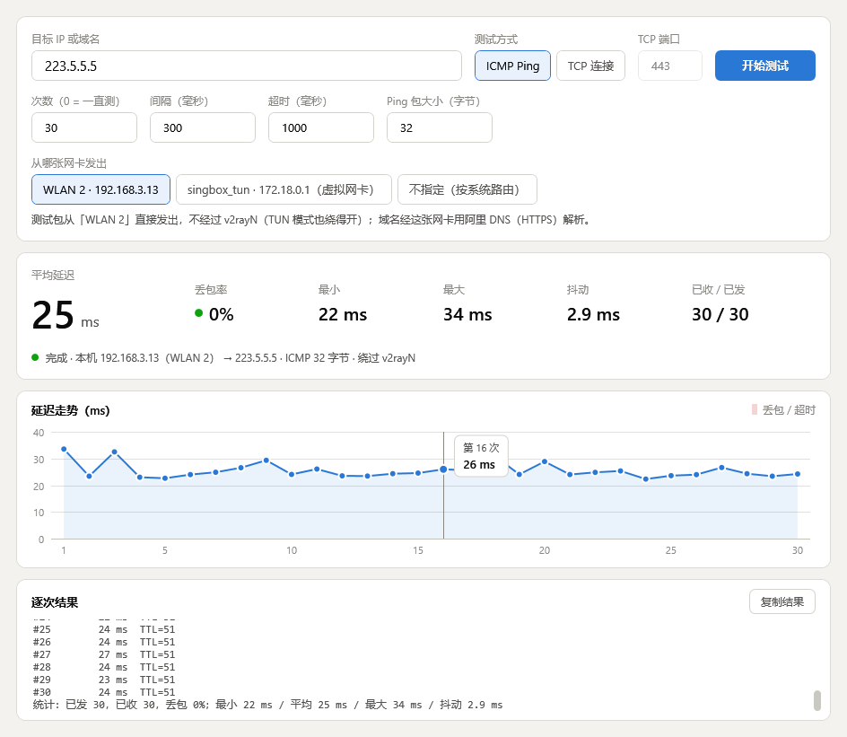
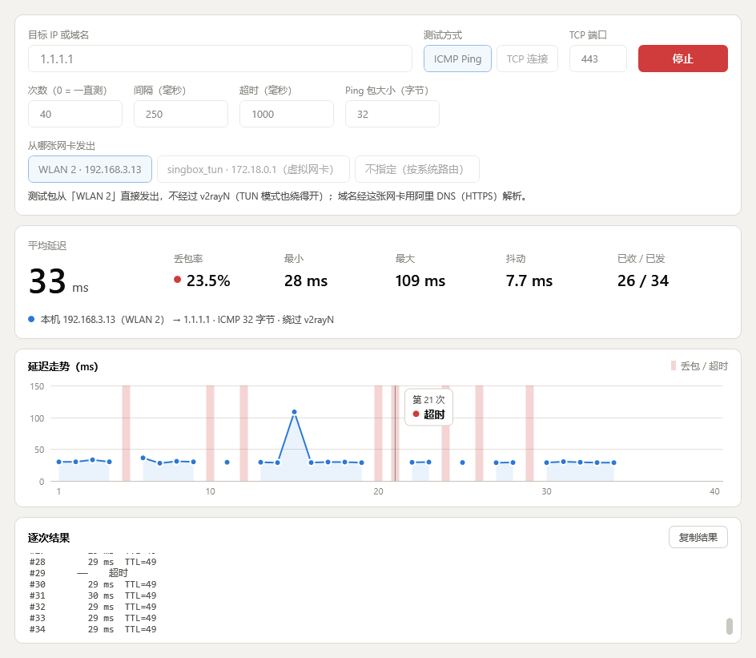
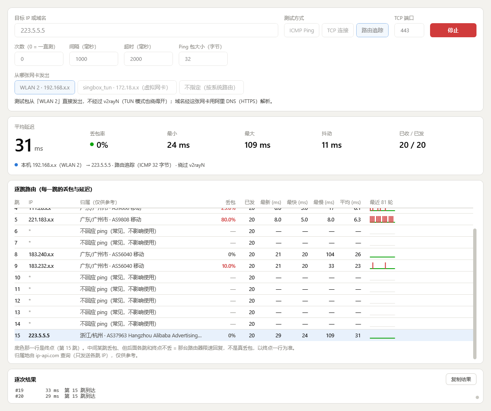

# IPQuality · IP 质量测试

[中文](#中文) · [English](#english)



---

## 中文

一个 Windows 绿色小工具，用来测试**本机到某个 IP 的网络质量**：延迟、丢包率、抖动，以及**逐跳路由追踪**（每一跳的丢包和延迟）。

- **绿色单文件**：只有一个约 110 KB 的 exe，不用安装，双击就开。
- **不留痕迹**：不写注册表、不写配置文件、不常驻后台，关掉窗口进程就退出。
- **能绕过代理软件**：v2rayN、Clash 等开着 TUN 模式时，普通 ping 会被它们接管，测出来的是假结果。这个工具可以指定从实体网卡（Wi‑Fi / 网线）直接发包，测到的才是真实网络质量。

### 功能

| 项目 | 说明 |
|---|---|
| 测试方式 | **ICMP Ping**；**TCP 连接**（测指定端口的握手时间，适合禁 ping 的服务器）；**路由追踪**（逐跳统计，见下） |
| 目标 | IPv4 地址或域名；直接粘贴 `IP:端口` 会自动切到 TCP |
| 参数 | 次数（0 = 一直测）、间隔、超时、Ping 包大小 |
| 出口网卡 | 自动选中实体网卡；也可以选「不指定（按系统路由）」做对比 |
| 结果 | 平均延迟、丢包率、最小、最大、抖动、已收 / 已发 |
| 图表 | 延迟走势图，丢包用红色竖条标出，鼠标悬停显示每一次的结果 |
| 其他 | 逐次结果列表、一键复制结果；跟随 Windows 深色 / 浅色模式 |

快捷键：回车开始，Esc 停止。



### 路由追踪（1.1.0 新增）

像 mtr / itdog 一样，每一轮同时探测第 1–30 跳，持续统计每一跳的情况：

- 每跳的 IP、归属（地区 · AS · 运营商，常见运营商用中文简称）、丢包率、已发次数、最新 / 最快 / 最慢 / 平均延迟；
- 「最近 N 轮」回应条：绿线 = 有回应，红色竖条 = 那一轮没回应，看得出丢包集中在什么时候；窗口越宽能看的轮数越多（最多 300 轮）；
- 到达终点后只探测到终点那一跳，底色那一行就是终点；上方的平均延迟、丢包率卡片也只算终点；
- 一次都不回应的跳显示灰色「不回应 ping」，不算丢包；
- 中间某跳丢包、但后面各跳和终点都不丢，是那台路由器限速回复 ICMP，不是真丢包——**以终点一行为准**（下图第 5 跳 80%，终点 0%，就是这种情况）；
- 表头固定、默认自动跟随到终点；窗口不够宽时表格可以左右滚动；「复制结果」会附上整张逐跳表。

归属地查询会把各跳的 IP（只有 IP 本身）发给 [ip-api.com](https://ip-api.com)；局域网和运营商内网地址在本地判断，不发送。归属数据仅供参考。



（截图已脱敏：除终点外的 IP 只保留前两段。）

### 下载和运行

到 [Releases](../../releases) 下载 `IPQuality.exe`，双击运行即可。

- 需要 Windows 10 / 11（系统自带 .NET Framework 4.8，不用另外安装）。
- 这个 exe 没有数字签名，第一次打开 Windows 可能会提示「已保护你的电脑」，点「更多信息 → 仍要运行」即可。不放心的话可以按下面的方法自己编译。
- 只支持 IPv4。

### 为什么能绕过代理软件

代理软件开 TUN 模式后，系统的默认路由会指向它的虚拟网卡。这时：

- ICMP Ping 可能直接由代理软件在本机回复（延迟不到 1 ms、TTL=255）；
- TCP 连接会在本机虚拟网卡上完成握手，测到的只是「本机到代理软件」的时间。

本工具把 ICMP 请求的源地址、TCP 套接字都绑定到实体网卡的 IP（TCP 另加 `IP_UNICAST_IF`）。Windows 是强主机模型，这样包只会从这张网卡发出去，不进 TUN。

域名解析也走实体网卡。v2rayN 的 strict_route 会拦截 TUN 以外的 53 端口，所以先用阿里 DNS 的 HTTPS 接口（223.5.5.5 / 223.6.6.6），失败再试普通 DNS。选「不指定」时用系统 DNS；如果解析出 198.18.x.x 这种 fake-ip，会提示结果不可信。

实测（v2rayN TUN 模式开着）：

| 目标 | 按系统路由（经 TUN） | 绑定实体网卡 |
|---|---|---|
| ICMP 1.1.1.1 | 0.3–1.1 ms，TTL=255（代理软件本地代答） | 29 ms，TTL=49 |
| TCP 1.1.1.1:443 | 约 0.9 ms（本地握手） | 超时（本地网络直连不通） |

### 常见问题

**TCP 测试一直超时，但节点明明能用？** 多半是端口填错了。NAT 机器的公网端口是映射出来的（比如公网 27443 → 机内 443），要填映射后的公网端口；或者直接用 ICMP Ping。TCP 第一次失败时软件会给出这条提示。

### 更新记录

- **1.1.0**：新增「路由追踪」模式（逐跳丢包、延迟、归属地、回应条）。
- **1.0.1**：TCP 连不上或被拒绝时提示可能原因（端口没开放 / NAT 要填映射端口）；图表纵轴刻度格式统一；标题显示版本号。
- **1.0.0**：首个版本。

### 自己编译

不需要安装任何 SDK，用 Windows 自带的 C# 编译器：

```bat
build.cmd
```

生成的 `IPQuality.exe` 在同一个目录里。图标是 `src\make-icon.ps1` 画的，改图标时才需要运行它。

### 文件说明

| 文件 | 内容 |
|---|---|
| `src/IpQuality.cs` | 全部源码（WPF 界面、ICMP / TCP 测试、路由追踪、DNS 解析、图表） |
| `src/app.manifest` | 高 DPI 与权限声明（普通用户权限即可，不需要管理员） |
| `src/app.ico`、`src/make-icon.ps1` | 图标及生成脚本 |
| `build.cmd` | 编译脚本 |

---

## English

A small portable Windows tool that measures **network quality from this PC to an IP**: latency, packet loss and jitter, plus a **hop-by-hop route trace** (loss and latency at every hop).

- **Portable single file**: one ~110 KB exe. No installer, just double-click.
- **Leaves nothing behind**: no registry writes, no config files, no background process. Closing the window ends the process.
- **Bypasses proxy clients**: when v2rayN, Clash and similar tools run in TUN mode, a normal ping is intercepted and the numbers are fake. This tool can send probes straight out of the physical adapter (Wi‑Fi / Ethernet), so you see the real network.

### Features

| Item | Details |
|---|---|
| Probe type | **ICMP ping**; **TCP connect** (handshake time to a port; useful when ICMP is blocked); **route trace** (per-hop statistics, see below) |
| Target | IPv4 address or domain name; pasting `IP:port` switches to TCP automatically |
| Options | Count (0 = run until stopped), interval, timeout, ping payload size |
| Outgoing adapter | Physical adapter selected by default; pick "system routing" to compare |
| Results | Average latency, loss rate, min, max, jitter, received / sent |
| Chart | Latency over time, lost probes marked with red bars, hover for each probe |
| Other | Per-probe log, copy results to clipboard, follows Windows dark / light mode |

Shortcuts: Enter to start, Esc to stop.

The interface is in Chinese.

### Route trace (new in 1.1.0)

Like mtr / itdog: every round probes hops 1–30 at the same time and keeps per-hop statistics.

- For each hop: IP, location (region · AS · carrier), loss, probes sent, last / best / worst / average latency;
- A "last N rounds" strip: green line = answered, red bar = no answer in that round, so you can see when loss happens. Wider windows show more rounds (up to 300);
- Once the target is reached, only hops up to the target are probed. The highlighted row is the target, and the summary cards above count the target only;
- Hops that never answer are shown in grey ("does not answer ping") and are not counted as loss;
- Loss at a middle hop while later hops and the target show none means that router rate-limits ICMP replies; it is not real loss. **Read the target row** (in the screenshot, hop 5 shows 80% while the target shows 0%);
- Sticky header, follows the target row automatically, scrolls sideways in narrow windows; "Copy results" includes the full hop table.

Locations are looked up by sending each hop's IP (the IP only) to [ip-api.com](https://ip-api.com). Private and carrier-grade NAT addresses are labelled locally and never sent. Location data is approximate.


(The screenshot is anonymised: every IP except the target keeps only its first two octets.)

### Download and run

Download `IPQuality.exe` from [Releases](../../releases) and double-click it.

- Requires Windows 10 / 11 (.NET Framework 4.8 is built in).
- The exe is not code-signed, so SmartScreen may warn on first launch. Choose "More info → Run anyway", or build it yourself (below).
- IPv4 only.

### How the bypass works

In TUN mode the proxy client takes over the default route. Then:

- ICMP pings may be answered locally by the proxy client (under 1 ms, TTL=255);
- TCP handshakes complete on the local virtual adapter, so you only measure "PC to proxy client".

The tool binds the ICMP source address and the TCP socket to the physical adapter's IP (plus `IP_UNICAST_IF` for TCP). Windows uses the strong host model, so the packets leave only through that adapter and never enter the TUN.

Name resolution also goes out through the physical adapter. v2rayN's strict_route blocks port 53 outside the TUN, so the tool first uses AliDNS over HTTPS (223.5.5.5 / 223.6.6.6), then falls back to plain DNS. With "system routing" it uses the system resolver and warns if it gets a 198.18.x.x fake-ip address.

Measured with v2rayN in TUN mode:

| Target | System routing (via TUN) | Bound to physical adapter |
|---|---|---|
| ICMP 1.1.1.1 | 0.3–1.1 ms, TTL=255 (answered locally) | 29 ms, TTL=49 |
| TCP 1.1.1.1:443 | ~0.9 ms (local handshake) | timeout (not reachable directly from this network) |

### FAQ

**TCP probes always time out, but the proxy node works?** Usually the port is wrong. On a NAT server the public port is a mapping (e.g. public 27443 → internal 443), so use the mapped public port, or just use ICMP ping. The app shows this hint on the first TCP failure.

### Changelog

- **1.1.0**: New "route trace" mode (per-hop loss, latency, location and answer strip).
- **1.0.1**: Hint with likely causes when a TCP probe times out or is refused (port closed / NAT needs the mapped port); consistent chart axis labels; version shown in the title bar.
- **1.0.0**: First release.

### Build from source

No SDK needed; it uses the C# compiler that ships with Windows:

```bat
build.cmd
```

`IPQuality.exe` is written next to the script. `src\make-icon.ps1` draws the icon and only needs to run if you change it.

### Files

| File | Contents |
|---|---|
| `src/IpQuality.cs` | All source code (WPF UI, ICMP / TCP probes, route trace, DNS, chart) |
| `src/app.manifest` | High-DPI and privilege settings (runs as a normal user, no admin needed) |
| `src/app.ico`, `src/make-icon.ps1` | Icon and the script that draws it |
| `build.cmd` | Build script |
